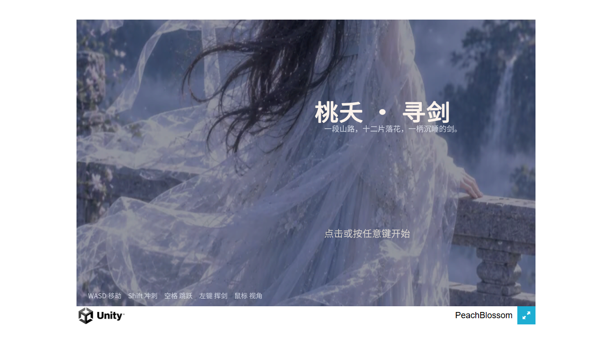
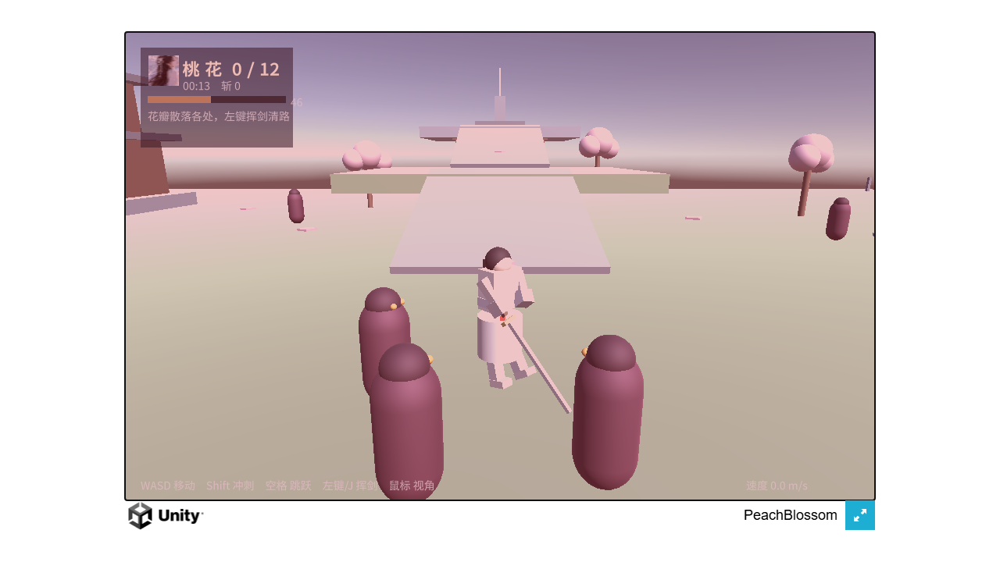
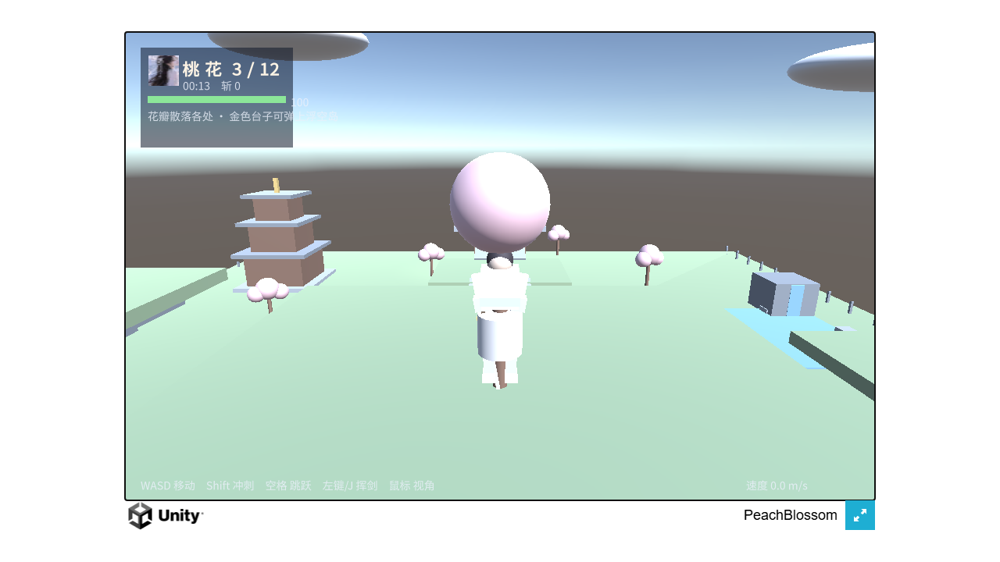
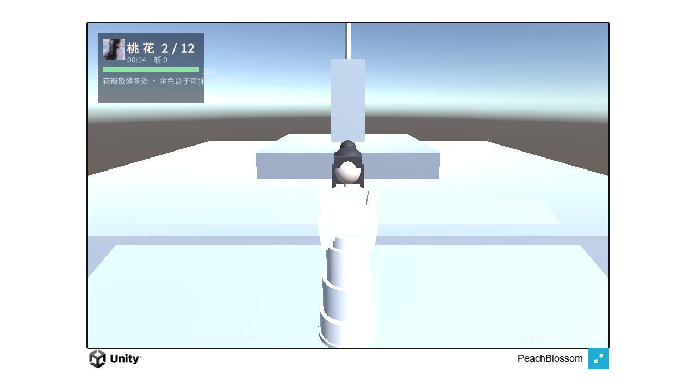

# 桃夭 · 寻剑

一个武侠题材的小型 3D 开放关卡：**探索山门 → 挥剑清路 → 收集十二片花瓣 → 唤醒剑碑 → 归剑**。

Unity 制作，场景、角色、特效、音效全部**运行时程序化生成**，不依赖任何外部美术资源。

### ▶ [在线试玩](https://yangbai-123.github.io/peach-blossom-game/)



## 玩法

- **探索**：70×70 的开阔山门，坡道、台阶、浮空岛、塔、湖泊、桃林
- **收集**：地图上散落 12 片花瓣，集齐后山顶的剑碑唤醒
- **战斗**：7 只妖物会主动追击，三段连击清路
- **通关**：走进剑碑光柱，归剑结局



## 操作

| 按键 | 动作 |
| --- | --- |
| W A S D | 移动 |
| Shift | 冲刺 |
| 空格 | 跳跃 |
| 鼠标左键 / J | 挥剑（三段连击） |
| 鼠标滚轮 | 拉近 / 拉远视角 |
| 鼠标 | 视角 |
| Esc | 释放鼠标 |

手机浏览器打开时自动切换为触屏操作：

| 触屏操作 | 动作 |
| --- | --- |
| 左下摇杆 | 移动 |
| 右侧拖动 | 转视角 |
| 右下红色按钮 | 挥剑 |
| 右下蓝色按钮 | 跳跃 |
| 右下圆形按钮 | 冲刺开关 |

## 战斗

- **三段连击**：伤害 18 / 20 / 32，0.85 秒内不继续攻击会重置连段
- **自动索敌**：起手时转向最近的敌人（前方 4.5m，贴身 2.6m 允许背身），并短暂锁住转向
- **打击感**：命中瞬间 50ms 顿帧 + 火花 + 击退 + 音效 + 屏幕泛红
- **敌人 AI**：待机 → 追击 → 前摇（身体压扁预警）→ 挥击
- **生命值**：玩家 100，敌人 60，玩家死亡后 1.2 秒原地复活

## 地图

| 位置 | 内容 |
| --- | --- |
| 出生点 | 平地，正前方是上山的路 |
| 山道 | 两段坡道 + 两级平台，通往山顶剑碑 |
| 山顶 (0, 5, 32) | 石台、石碑、悬浮的剑与灵光 |
| 塔 (-24, 0, 18) | 三层塔 |
| 湖 (22, 0, 4) | 水面、假山、细流、池边石 |
| 桃树 ×8 | 树干 + 三团粉色花冠 |
| 浮空岛 ×3 | y = 7 / 9.5 / 12.5，各藏一片花瓣 |
| 弹跳台 ×3 | 站上去自动弹到对应浮空岛 |



## 主角

白衣、长发、佩剑的剑仙造型，完全由基础几何体拼装，配合程序化动画：

- **层叠长裙**：五段圆台从腰部到脚踝逐级外扩
- **长发**：后披、鬓发、刘海、发髻，外加三朵白色花饰
- **宽袖**：袖口加宽，跑动时随身体摆动
- **佩剑**：剑身、护手、剑穗，挥击时沿弧线劈出
- **动画**：走路摆臂、跳跃收腿、三段劈砍、裙摆与长发随速度后飘



## 音效与特效

全部是程序化生成的，没有任何音频或贴图文件：

- **音效**：运行时合成波形——挥剑是噪声扫频，命中是低频撞击 + 噪声，受伤是方波下滑，拾取是双音阶提示音，死亡是下坠音
- **粒子**：大量小方块模拟火花与花瓣碎片，带重力、旋转、缩小消失
- **刀光**：沿挥剑弧线生成一串小火花

## 技术实现

```
Assets/Demo/Scripts/
  GameBootstrap.cs       入口：搭地图、造角色、生成敌人、接相机/HUD
  GameManager.cs         流程：标题/游玩/结局，花瓣、击杀、计时、复活
  GameHUD.cs             所有 UI：标题页、HUD、结局页、受伤泛红
  PlayerMotor.cs         移动核心：加减速、转向、重力、跳跃、坡道、弹射
  PlayerStateMachine.cs  状态机：Idle / Move / Sprint / Jump / Fall
  PlayerController.cs    输入层
  ThirdPersonCamera.cs   第三人称相机
  Combat/Health.cs       通用生命值 + 无敌帧
  Combat/PlayerCombat.cs 三段连击、球形判定、打击感
  Combat/Enemy.cs        敌人 AI、受击闪白、击退、死亡
  Visual/HumanoidRig.cs  程序化人形：拼装 + 走路/跳跃/挥剑动画
  Visual/MaterialLibrary.cs 材质库
  Fx/Fx.cs               粒子爆炸、刀弧火花、顿帧
  Fx/Sfx.cs              程序化音效合成
  Collectible.cs         花瓣拾取
  BouncePad.cs           弹跳台（距离触发 + 抛物线落点）
  ShrineGate.cs          剑碑解锁与结局
```

几个实现要点：

- **移动**：`CharacterController` 驱动，自己算加减速和转向，碰撞交给引擎
- **空中动量**：空中无输入时保持水平速度，否则弹射会被地面减速吃掉
- **弹跳台**：按抛物线反解横向速度，站上去不按任何键也能准确落到岛上

## 素材与授权

| 内容 | 来源 | 授权 |
| --- | --- | --- |
| 主角 3D 模型 スリクオちゃん | [なみぞー](https://hub.vroid.com)（VRoid Hub） | 允许商用与修改，**必须署名** |
| 怪物 3D 模型 | VRoid Project（VRoid Hub） | 允许商用与修改，无需署名 |
| 人物立绘 | 项目自带 | 仅用于本项目 |
| 场景 / 怪物 / 特效 | 运行时程序化生成 | 无外部素材 |
| 音效 | 运行时合成 | 无外部素材 |

主角模型通过 UniVRM 在运行时加载（`Assets/Demo/Resources/Models/character.bytes`），骨骼动画由 `VrmCharacterRig` 程序化驱动，没有使用 Animator Controller。加载失败会自动退回程序化人形。

## 本地运行

用 Unity Hub 打开本工程，打开 `Assets/Demo/Scenes/Main.unity`，按 Play。

Unity 版本：**6000.6.10f1**（2021.3 / 2022.3 也可，会提示升级工程）。
